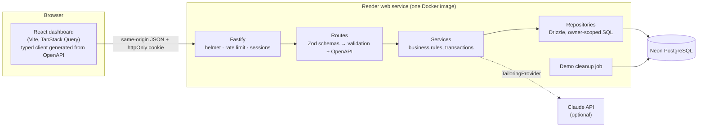

# ApplyTrack

[](https://github.com/anarchygene/applytrack/actions/workflows/ci.yml)

**A contract-first REST API for running a job search like a sales pipeline**, with a light React
dashboard on top. You can track applications through hiring stages with a dated timeline, get
automatic follow-up reminders, see SQL-computed statistics about what's working, and optionally
have Claude tailor your resume bullets to a specific job post.

> **Live demo:** _add your Render URL here after deploying_. Click **Try the demo** to get a
> private sandbox account pre-filled with sample data, deleted automatically after 24 hours.
> Interactive API reference: `/docs`.

The backend is the focus of this project. It was built spec-first with
[GitHub Spec Kit](https://github.com/github/spec-kit). The constitution, specification, research,
data model, API contract and task list are all in [`specs/`](specs/001-job-tracker-mvp) and
[`.specify/memory/constitution.md`](.specify/memory/constitution.md).

---

## Highlights

| Area | What it demonstrates |
|------|----------------------|
| **Contract-first API** | One Zod schema per route drives runtime validation, TypeScript types and the OpenAPI 3.1 document. The frontend client is *generated* from that document, and CI fails if the committed contract drifts from the code. |
| **Consistent errors** | Every error is RFC 9457 `application/problem+json` with a stable machine-readable `code`, field-level validation errors and a request id. |
| **Security** | argon2id password hashing, opaque session tokens stored only as SHA-256 hashes, sliding 7-day expiry, httpOnly `SameSite=Lax` cookies or Bearer tokens, timing-safe login, per-route rate limits, strict CSP and helmet headers. Every query is scoped by owner at the repository layer, so other users' records return `404`. |
| **Data & SQL** | PostgreSQL with Drizzle ORM, versioned migrations, check constraints and composite indexes. Statistics use one CTE with `GROUP BY ROLLUP` for overall plus per-source funnels, and `generate_series` for zero-filled weekly counts. |
| **Domain logic** | Stage-transition rules, applied-date stamping in the user's time zone, and transactional stage changes that write the timeline event, update the application and create the automatic follow-up atomically. |
| **Optional AI** | Claude structured outputs validated against a Zod schema, behind a provider interface. Timeouts, input caps, a rolling 24-hour per-user quota stored in the database, and graceful `503` when not configured. Tests use a fake provider. |
| **Testing** | 80 Vitest tests: unit tests for pure domain logic, and HTTP-level integration tests (`fastify.inject`) against a **real PostgreSQL**, including a cross-user isolation suite and a hand-calculated statistics dataset. |
| **Operations** | Structured pino logs with request ids and secret redaction, `/health` + `/ready`, Zod-validated env config that fails fast, graceful shutdown, multi-stage Docker image, GitHub Actions CI, Render blueprint. |

## Architecture



```
apps/
├── api/                       Fastify + TypeScript (the focus)
│   ├── src/
│   │   ├── app.ts             buildApp(): plugins, error contract, docs, routing
│   │   ├── server.ts          entrypoint: config, migrations, graceful shutdown
│   │   ├── config.ts          Zod-validated environment
│   │   ├── db/                schema, client, migrator
│   │   ├── domain/            pure logic: stage transitions, reminders, dates
│   │   ├── lib/               auth/session plugin, problem+json errors, shared schemas
│   │   ├── modules/           auth · applications · reminders · stats · tailoring
│   │   │                      (routes → service → repository per module)
│   │   └── jobs/              demo account cleanup
│   ├── drizzle/               SQL migrations (committed)
│   ├── openapi.json           generated API contract (committed, drift-checked in CI)
│   └── test/                  unit/ and integration/ suites
└── web/                       React + Vite + Tailwind dashboard (a thin API client)
specs/001-job-tracker-mvp/     Spec Kit: spec, plan, research, data model, contract, tasks
```

## API at a glance

The full interactive reference is served at **`/docs`** (Scalar), generated from the code.

| Method | Path | Purpose |
|--------|------|---------|
| `POST` | `/v1/auth/register` · `/login` · `/logout` · `/demo` | Accounts and sessions |
| `GET` `PATCH` `DELETE` | `/v1/me` | Profile, time zone, account deletion |
| `GET` `PUT` | `/v1/me/resume` | Base resume for AI tailoring |
| `GET` `POST` | `/v1/applications` | Search, filter, sort and paginate; create |
| `GET` `PATCH` `DELETE` | `/v1/applications/{id}` | Read, update, delete |
| `POST` | `/v1/applications/{id}/stage` | Move through the pipeline (validated transitions) |
| `GET` | `/v1/applications/{id}/timeline` | Stage history |
| `GET` · `POST` · `PATCH` `DELETE` | `/v1/reminders` · `/v1/applications/{id}/reminders` · `/v1/reminders/{id}` | Overdue / today / upcoming reminders |
| `GET` | `/v1/stats` | Funnel, weekly pace, response rate by source |
| `GET` · `GET` `POST` | `/v1/ai/status` · `/v1/applications/{id}/tailorings` | Optional AI resume tailoring |

```bash
# Example: start a demo session and query it with the returned bearer token
TOKEN=$(curl -s -X POST localhost:4000/v1/auth/demo | jq -r .token)
curl -s localhost:4000/v1/stats -H "Authorization: Bearer $TOKEN" | jq '.responseRate, .bySource'
```

## Running locally

Prerequisites: Node.js ≥ 22.12 (24 LTS recommended) and Docker.

```bash
npm install
cp apps/api/.env.example apps/api/.env
docker compose up -d db          # PostgreSQL 17 on localhost:5433 (dev + test databases)
npm run db:migrate
npm run dev                      # API on :4000, dashboard on :5173 (proxied, same origin)
```

Open http://localhost:5173 and click **Try the demo**, or browse the API at
http://localhost:4000/docs. To enable AI tailoring, set `ANTHROPIC_API_KEY` in `apps/api/.env`.

### Configuration

| Variable | Default | Purpose |
|----------|---------|---------|
| `DATABASE_URL` | – (required) | PostgreSQL connection string (`?sslmode=require` for Neon) |
| `DATABASE_URL_UNPOOLED` | falls back to `DATABASE_URL` | Direct connection used only for migrations (Neon's non-`-pooler` URL) |
| `PORT` / `HOST` | `4000` in `.env.example` (`3000` in Docker) / `0.0.0.0` | Listen address |
| `LOG_LEVEL` | `info` | pino level, or `silent` |
| `COOKIE_SECURE` | `false` (`true` in Docker) | Send the session cookie over HTTPS only |
| `MIGRATE_ON_START` | `false` | Apply migrations before listening |
| `WEB_DIST_DIR` | – | Serve the built dashboard from this directory |
| `ANTHROPIC_API_KEY` | – | Enables AI tailoring when set |
| `ANTHROPIC_MODEL` | `claude-opus-5-5` | Model for tailoring (`claude-haiku-5-5` is much cheaper for a public demo) |
| `AI_DAILY_LIMIT` | `10` | Tailoring requests per user per rolling 24 hours |
| `AI_ALLOW_DEMO` | `false` | Let temporary demo accounts use AI |

## Testing

```bash
npm run lint && npm run typecheck && npm test
```

- **Unit** (`apps/api/test/unit`): stage transitions, reminder grouping, time-zone date maths.
- **Integration** (`apps/api/test/integration`): every user story through HTTP against the
  `applytrack_test` database, with tables truncated before each test. Includes
  `isolation.test.ts` (no cross-user access on any route), `stats.test.ts` (hand-calculated
  reference dataset), a rate-limit test, and an OpenAPI completeness check.
- An injectable clock makes session expiry, reminder due dates and the AI quota window
  deterministic.

## Deployment (Render + Neon, free tiers)

1. Create a Neon project and copy two connection strings from **Connect**: the **pooled** one
   (hostname contains `-pooler`) and the **direct** one (pooling toggled off).
2. In Render, choose **New → Blueprint** and select this repository. `render.yaml` defines one
   Docker web service.
3. When prompted, paste the pooled URL into `DATABASE_URL` and the direct URL into
   `DATABASE_URL_UNPOOLED` (optionally also `ANTHROPIC_API_KEY`). Migrations run on start
   (`MIGRATE_ON_START=true`) over the direct connection, as Neon recommends, while the app's
   queries use the pooler.
4. Check `https://<service>.onrender.com/health`, then try the demo.

The dashboard is served by the API from the same origin, so cookies stay first-party. This avoids
the third-party-cookie problem a separate static site on `onrender.com` would have, because that
domain is on the public suffix list.

## How it was built: Spec-Driven Development

This repo follows the [Spec Kit](https://github.com/github/spec-kit) workflow:

1. **Constitution**: non-negotiable principles (contract-first, test-first on real Postgres,
   secure by default, layered simplicity, operability, graceful optional integrations).
2. **Specify**: user stories with priorities and acceptance scenarios, plus functional
   requirements and measurable success criteria.
3. **Plan**: research decisions with alternatives considered, data model, HTTP contract and
   quickstart, checked against the constitution.
4. **Tasks**: 65 tasks ordered by user story so each slice is independently testable.
5. **Implement**: tests and code per story, checked off in `tasks.md`.

## Possible next steps

- Email or push delivery for reminders (a job queue would be justified at that point)
- Password reset and email verification
- CSV import/export and a browser extension to save postings
- Redis-backed rate limiting for running more than one instance

## License

MIT
